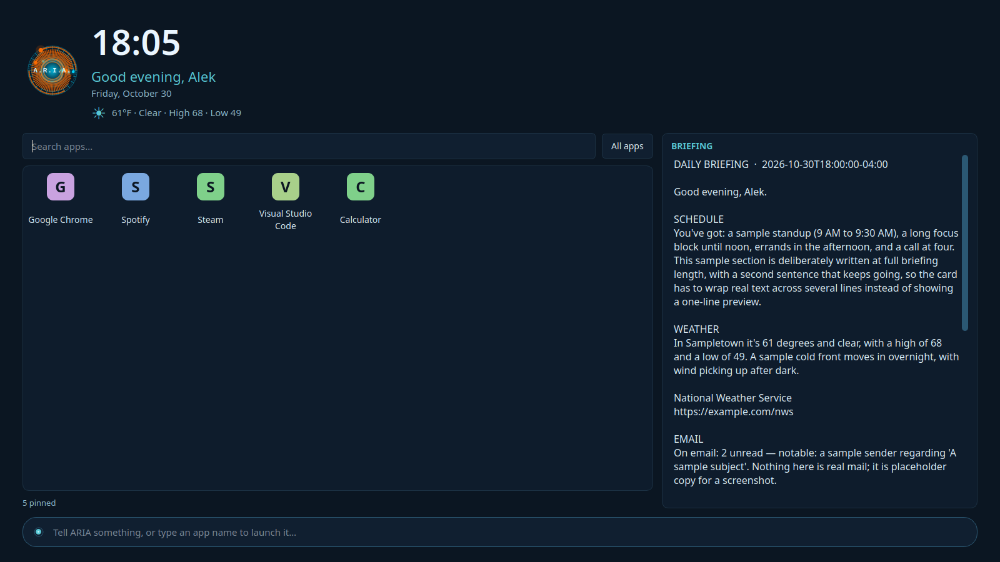
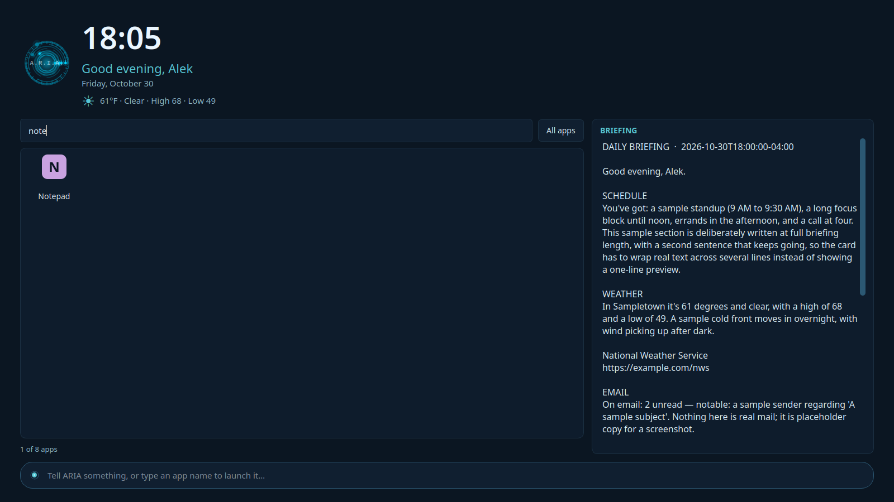
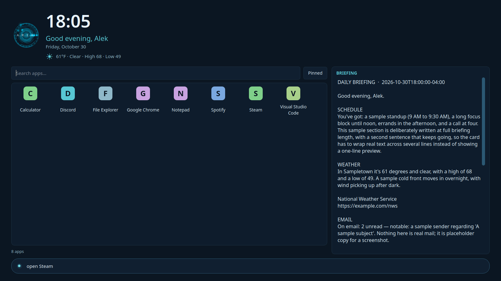

# A.R.I.A. — Adaptive Robotic Intelligence Agent

A personal desktop assistant with a face, a voice, and a memory — she lives on
your Windows PC as a native Qt command center, talks in a natural neural voice,
drives the computer by voice or text, and remembers what you tell her across
sessions.

ARIA is built by **Alek Berger**. Her dashboard, centrepieces, desktop pet and
several subsystems are ported from his **Mark-LVI-ARIA** fork — whose engine,
avatar and HUD lineage is the **MARK LVI** codebase by **FatihMakes** — and
grown well past it: a real inbox and calendar, a media system that reads every
app on the machine, an Android phone she can drive, and a task engine that
survives its own restarts.

> **Licence: CC BY-NC 4.0** — the ported MARK LVI material is © FatihMakes,
> attribution required, non-commercial use only. Full attribution and licence
> texts live in [`LICENSES/`](LICENSES/). Upstream project:
> [github.com/FatihMakes/Mark-LVI](https://github.com/FatihMakes/Mark-LVI) ·
> [@FatihMakes on YouTube](https://www.youtube.com/@FatihMakes)

---

## Architecture

**Engines.** The default conversation engine is a **multi-provider
function-calling loop** (`aria/agent/`): Gemini first, then Ollama Cloud,
Groq, OpenRouter and Mistral, in the chain
`gemini → ollama_cloud → groq → openrouter → mistral` (a chain saved in your
settings wins over the default). Failures are classified per
(provider, model) — a rate limit cools that one rung down (60s provider /
300s model), an auth failure rests it longer, a 400 never cools anything —
and the walk skips resting rungs instead of hammering them. There is no
arbitrary turn cap: a request gets a 30-minute reasoning budget, and on
timeout she asks "Should I keep going?" — "yes" resumes the same chain.
Tool names are never fuzzy-matched into execution: an unknown or
misspelled name is refused, the closest real tool is only *suggested*,
and a corrected call re-enters the same approval and safe-mode gates as
any other call.

**Gemini key pool.** `aria_keys.json` may carry `GEMINI_API_KEYS` as a
list — the chain then expands into one Gemini rung per key
(`gemini`, `gemini_2`, …), so the failover walk *is* the rotation and
each key keeps its own cooldowns. Live mode and embeddings ride the
first key. One caveat that matters: free-tier quota is per Google
*project*, so pool keys only add headroom when they were minted in
separate projects.

**Task-based routing.** The conversation stays on the chain's front rung
while heavy roles route by name, never hard-coded: vision runs on
gemma4:31b-cloud and background code work on qwen3-coder:480b-cloud through
Ollama Cloud (override via `OLLAMA_VISION_MODEL` / `OLLAMA_CODE_MODEL`;
empty disables the role). A retired model tag can never break her — an
HTTP 410 parks the dead model and the chain moves on, and the key that
served it is never quarantined for a model's death.

**Gemini Live (opt-in).** Set `"voice_mode": "live"` in the settings file
and conversation moves to a Gemini Live session (`aria/live.py`) — Google's
servers handle hearing, turn-taking and speech in one stream, in the Kore
voice, with her tools routed through the same dispatch as everything else.
The microphone pauses while presence says you're away, and if Live drops,
the pipeline engine re-arms the wake-word listener and takes over. The
default stays the pipeline: Live is a mode, not a dependency.

**Persona.** Her identity — name, whose she is, the standing rules she works
under — lives in `soul.md` at the repo root, loaded at boot. It is on her
self-edit watchlist like any code file. Switchable overlays (`concise`,
`coach`) layer on top via `set_persona`; her soul stays her soul.

**Memory.** Three layers (`aria/memory.py`): a SQLite semantic-vector store
for facts, a Markdown journal, and an unbroken **memory spine**
(`memory_spine.jsonl`) logging turns, tool invocations and journal entries;
session context (`where_we_left_off.md`) is restored at boot so she picks
up where you left off. A nightly **consolidation** pass reconciles the
store — duplicates are skipped, and contradictions are never overwritten:
they queue in `memory_contradictions.json` for the `memory_review` tool,
with the losing version archived to `memory_retired.json`. Nothing is ever
silently deleted. The dashboard's **Memory tab** shows the store
directly — every fact, newest first, with a per-row forget (✕) that
removes exactly that fact.

**Delegated tasks, journaled.** `delegate_task` runs multi-step work in the
background through a durable journal (`aria/agent/taskstore.py`): every
step checkpoints as it finishes, a crash or restart marks in-flight work
*blocked* instead of losing it, `task_resume` continues a blocked task
skipping the steps already done, a step that needs you parks as
*blocked_input* with its question attached, and a skeptical verifier turn
checks the result before she calls it done. She never replays a finished
step and never claims a step she didn't run.

**Presence.** `aria/presence.py` watches input idle: away past the
threshold, every *unprompted* path goes silent — proactive speech, the
briefing, check-ins — while anything you ask for still answers instantly.
Return after a long absence and she greets you once. Presence gates speech,
never obedience.

**Self-restart with a net.** She can edit her own codebase. The agent
fingerprints every `.py` file in `aria/` plus `soul.md` at boot; a verified
change cleanly re-executes her — but only after the changed files pass a
syntax check **and an import smoke test in a fresh interpreter**. A broken
edit is preserved as `<file>.broken-<epoch>` and the committed copy is
auto-restored from git: a bad self-edit can't brick her. The watcher is
scoped to the package + root launcher, so test and probe edits can't
trigger it. Updates restart her program only — never the computer.

**Failure records.** Tool failures, incidents and self-heal diagnoses land
in her logs and the Activity tab, colour-coded by level; the self-healing
loop (`system_health_audit`, `self_heal_diagnose`) records what broke,
diagnoses it, and attempts recovery on the classes that have a designed
remedy.

---

## Capabilities

**130 tools** on a desktop install, organised into progressive toolkits:
only the core schemas ride along per call, and specialist toolkits unlock
on demand (`load_toolkit`) or automatically from keywords in your request.
Tools from connected MCP servers join on top of that, namespaced per
server. The in-app **Commands** catalog (`Ctrl+K`) is the source of truth:
it is rebuilt from the live registry every time it opens, so it cannot list
a tool she doesn't have — and clicking a command runs it. The shape of the
suite:

| Area | What's there |
|---|---|
| Computer & files | `launch_app`, `open_app_or_url`, window control (`list_windows`, `focus_window`, `minimize_window`, `close_window`, `window_snap`), GUI control (`gui_click`, `gui_type`), clipboard (`clipboard_read`, `clipboard_write`), `run_python_code` (sandboxed), `run_shell_command` (a real shell behind an on-screen CONFIRM of the exact command — never from routines or delegated tasks), `browser_control` (open a URL, or fetch a page's text), `browser_agent` (a supervised real-browser driver in her own profile — one action per call, irreversible clicks like pay/send/delete are stashed for approval instead of executed, private addresses refused), the File Commander (`file_organize` — dry-run plan first, always; `file_find_advanced`, `find_file`, `file_duplicates`, `disk_usage`), `process_file`, `fetch_url`, `web_search`, `research` (deep multi-source briefs — reads the sources, cites them, cross-checks its own claims, files the brief to the Briefing tab) |
| Travel & games | `flight_finder` (builds and opens a Google Flights search — prices live on the page and are never invented), `game_updater` (Steam: list installed games, report flagged updates, queue a validate/update; Epic honestly unsupported) |
| Media | `media_control` (one tool over her own video player and the system: play/pause, seek by fraction or seconds, volume), `spotify`, `media_key`, `volume`, `dj` — transport is explicit and verified, aimed at the real media session (see NOW PLAYING, below) |
| Phone node | `phone_status`, `phone_list_apps`, `phone_open_app`, `phone_read_screen` (accessibility tree with tap targets), `phone_notifications`, `phone_tap`, `phone_swipe`, `phone_type`, `phone_key` — via the ARIA Node Android app |
| Vision & body | `describe_camera`, `take_photo`, `vision_look`, `read_screen`, `take_screenshot`, `face_tracking`; robot body: `move_head_servos`, `drive_wheels`, `body_stop` (Arduino Nano pan/tilt head + differential drive) |
| Connections | Gmail (`gmail_setup`, `read_email`, `send_email`, `triage_email`), calendar (`calendar_setup`, `check_calendar` — RRULE/EXDATE/RDATE recurrence honoured), GitHub (`github_create_repo`, `github_push_file`), MCP (`mcp_setup`, `mcp_connect`, `mcp_disconnect`, `mcp_list_servers`, `mcp_remove_server`) |
| Routines | `routine_record_start/stop`, `run_routine` (with `{{parameter}}` slots), `list_routines`, `describe_routine`, `delete_routine`, `trust_routine`, `untrust_routine`, `export_routine_pack`, `import_routine_pack` |
| Scheduling & watches | `set_timer`, `set_reminder`, `set_recurring_task`, `list_scheduled_tasks`, `cancel_scheduled_task`, `break_reminders`; `os_reminder` (registered with the Windows Task Scheduler, so it fires even when ARIA is closed — `set_reminder` cannot promise that); price watches (`watch_price`, `check_price_watches`, `list_price_watches`, `unwatch_price` — the hourly checker actually fires), screen watches (`watch_screen`, `list_screen_watches`, `unwatch_screen`) |
| Delegation & autonomy | `delegate_task`, `task_status`, `task_cancel`, `task_resume`; `event_trigger` (when-this-then-task: email rules, folder drops, presence return — auto, or ask-first via a pending approval; per-trigger cooldown, every firing logged); `manage_autonomous_goal`, `manage_background_job`, `system_health_audit`, `self_heal_diagnose`; `update_status` (git HEAD + live fleet/task state), `code_helper` (explain / fix / write code via the code model), `dev_agent` (plan + write a complete single-file program) |
| Notes, memory & cards | `take_note`, `read_notes`, `journal_write`; `save_memory`, `search_memory`, `forget_memory`, `memory_review`; `mtg_card`, `mtg_advice` (Scryfall, keyless) |
| Herself | `morning_briefing`, personas (`set_persona`, `get_persona`, `list_personas`), the approval layer's read-only views (`get_approval_mode`, `list_pending_approvals` — approvals themselves resolve only from the dashboard's confirm banner and the mode only in Settings, never by the model), self-edit (`edit_own_code`, `patch_own_code`), `restart_program` (relaunch herself on a direct command — never the computer, never from a routine or delegated task), `notify_phone` (toast + Web Push + missed queue; rate-limited, and never sent from delegated work), `set_backup_mirror` (mirror the memory DB, settings, and chat history to a folder you choose — keys never mirror), `reload_user_tools`, `show_commands`, `hide_commands`, `bridge_token` |

**Startup briefing.** Her greeting and the `morning_briefing` tool compose
the same source-backed report in code: today's calendar (recurring events
expanded), a short tomorrow preview, important recent email, local weather,
local headlines and world headlines — every story deduplicated across
sources, so one story appears once. Sources are dated (news within 48
hours), linked, and share a 14-second budget; a disconnected or failed
source is named as such instead of described as empty. The **Briefing** and
**News** tabs show the same report in the dashboard and on the phone.

**Tool SDK.** Drop a Python file in `aria/tools/user_tools/` defining
`TOOL_NAME`, `TOOL_DESCRIPTION`, `TOOL_PARAMETERS` and `run(args)`, and she
learns a new skill at boot (`reload_user_tools` picks up changes live).
Five-minute guide in `docs/USER_TOOL_SDK.md`.

---

## The UI

A native PyQt6 command center in three columns — no browser, no web view.

- **Left — SYS MONITOR + media.** Live per-subsystem status rows (voice,
  vision, memory, servos, scheduler, GitHub, autonomy — green / amber /
  red from real probes, never painted labels), the **NOW PLAYING** panel,
  and the system volume slider.
- **NOW PLAYING.** Whatever is actually playing, not just Spotify. Source,
  in order: her own video player when it has media loaded (exact
  position/duration, a real progress bar); the active Windows media
  session via **SMTC** (`aria/smtc.py`, on the `winsdk` wheel) — Spotify,
  Media Player, Movies & TV, VLC, a browser, anything Windows knows
  about; then by-process window-title fallbacks for when SMTC is
  unavailable. State is honest: `● NOW PLAYING` green while playing,
  `❚❚ PAUSED` with the track still named — no standby placeholders, no
  fabricated progress. **Play and Pause are separate buttons**, and
  transport is closed-loop: the command aims at the specific session (no
  focus-stealing, no blind global toggle), the state is re-read, and if
  the session ignored it, the call escalates to the system media key and
  verifies again.
- **Centre — her face.** A **neural field** — precomputed nodes and wiring
  with signal pulses travelling the edges, in her state colours — spans
  the whole centre card on a black backdrop, top to bottom: behind the
  centrepiece, the state line and the Hold to talk buttons.
  The centrepiece is one of four, chosen in Settings → Customize: the
  **Resonance orb** (her voice drawn as a polar waveform ribbon around
  her name, driven by her live audio level history), the **holo face**
  (real measured geometry — MediaPipe's canonical face model, 468
  vertices, Apache-2.0 — with a viseme mouth shaped by the speech
  itself), the **memory map** (a constellation of her stored facts —
  hover a node to read the fact; the Memory tab can jump it into the
  centre, and its ✕ returns to the orb), and the **3D waveform orb**
  (the orb rendered as a rotating 3D wireframe). A video panel takes
  the centre while media plays in-app. The classic OpenCV HUD (pixel avatar,
  context tiles) remains as a fallback layout
  (`ARIA_UI_LAYOUT=classic`).
- **Right — the Workspace, eight tabs:** **Conversation | Inbox |
  Calendar | Tasks | Activity | Briefing | News | Memory**. Inbox is a real mail client (subjects and senders
  decoded, local dates, bodies in a reading pane; IMAP reads use
  BODY.PEEK — reading never marks mail as seen). Conversation and
  Activity are colour-coded Mark-LVI style: ARIA in cyan, you in white,
  system lines muted; activity entries earn red / amber / green by level.
- **Header:** a live services summary — click it for the per-service
  dialog — the clock, and **Settings**, the only header button.
- **Settings** (`aria/ui_panels.py`) has eight tabs: **General** (startup
  briefing, safe mode, approval mode, accent presets, the **app lock** —
  set/change the lock password, Lock ARIA — and the **console window**
  toggle: the black log window is hidden by default and can be shown
  here), **Voice / audio**
  (voice gate, whisper, volume, Edge voice, microphone chooser),
  **Providers** (read-only: the live chain, each rung's state and model,
  failover stats), **Extensions** (read-only: MCP servers and the
  built-in tool count), **Customize** (an accent hue wheel — picking
  previews live and re-derives the whole colour family, neural field and
  orb included), **Pet**, **Daily briefing** (name, area, timezone,
  topics), and **Connections** (credentials — never through the chat —
  plus Remote Control). Settings save atomically; blank key fields keep
  the stored value.
- **Pet mode.** The Pet button replaces the whole UI — dashboard *and* any
  open dialog close — leaving the floating desktop pet: the character, or
  the waveform orb at pet size, switchable from its right-click menu.
  Drag her anywhere (the spot is remembered); pet mode is sticky across
  restarts.
- **Talking to her:** voice (wake word or push-to-talk — hold the mic
  button or SPACE), typing in the command bar (Unicode welcome), or
  dropping a file on the window. **Esc** stops her speech mid-sentence.
  There is deliberately no live speech subtitle under the state line.

Her camera works on demand — ask her to look, and the view appears as a
small picture-in-picture in the centre card while she's looking. There
is no ambient, always-on camera tile.

---

## Shell Mode (the ARIA OS layer)

**Your computer, run by conversation.** Shell Mode is ARIA's optional
home layer for Windows, built in — not a separate program. Windows
itself — the kernel, the drivers, every app and game you own — stays
exactly where it is. What changes is the part you live in: instead of
a desktop of icons, ARIA can boot into **Shell Home**, a fullscreen
home screen in her navy/cyan identity. It began life as the separate
ARIA OS project (2026-10-30) and was folded into this repo at the
author's direction: one program, ARIA, with Shell Mode built in.



- **Shell Home** (`aria/shell_panel.py`) — an OS home, not a
  settings panel: big clock, date, and time-of-day greeting with
  her live waveform orb beside it (the dashboard forwards its
  voice state/level to the shell's orb while Shell Home is open,
  so it breathes with her voice), the local weather under the date
  (condition symbol + temperature and the day's high/low, from
  the same wttr.in source her briefings use — fetched off the
  UI thread, refreshed at most every ~15 minutes, and simply
  absent when the source can't be reached), a **tile grid** of
  your apps, a right
  rail given over to the Briefing card, and the command bar as
  a dock pill along the bottom. Open it any time with the **Shell Home** button in the
  dashboard's centre column. Opening it gives Shell Home the
  **whole window**: the System Monitor and Workspace columns
  step aside, and Exit restores them — divider positions
  included — exactly as they were.
- **App launcher** (`aria/app_launcher.py`) — your actual Start
  Menu, enumerated from its shortcuts (per-user and all-users roots,
  deduped and sorted), with ranked search: exact matches first,
  then name-prefix, word-prefix, and substring. Tiles show the
  real shortcut icon on Windows (Qt's icon provider) and a
  coloured letter tile everywhere else; double-click or Enter
  launches — once: the panel has a single launch path plus a
  same-app relaunch guard, so one double-click opens one window.

  
- **Pinned apps** — Shell Home opens to just the apps you pin:
  right-click any tile (in the full list or in search results)
  for **Pin to Home** / **Remove from Home**. Pins are Start
  Menu shortcut paths kept in pin order in `ui.json`
  (`aria/ui_prefs.py`); a shortcut that disappears is skipped
  silently. The **All apps** toggle beside the search box
  reveals the full list; search always searches everything,
  and with nothing pinned the grid shows a short how-to note
  instead of a void. The count line follows the view —
  "8 pinned", "210 apps", "3 of 210 apps".
- **The rail is Briefing, only** — the card fills the rail's whole
  height and carries **the same text as the Workspace Briefing
  tab**: `report_text` of the last composed briefing (header,
  intro, every titled section, source blocks) plus the research
  section, appended the same guarded way the tab appends it —
  composed by the pure `briefing_full_text` helper in
  `aria/shell_home.py` and shown in a read-only view at reading
  size, so a typical briefing reads whole on the home screen.
  (Earlier shells also carried Now Playing and Status cards;
  they were removed at the author's direction — the briefing
  earned the space.) No briefing composed yet reads as the tab's
  own placeholder line; nothing is ever fabricated.
- **Command bar** (`aria/shell_home.py`) — one input for everything,
  in the bottom dock pill. An unambiguous app name (`Steam`,
  `open Chrome`) launches it. Anything else goes to ARIA as a
  normal conversation turn — through the exact same dispatcher,
  **approval gates, and safe mode** she already has. The shell
  adds no new powers and bypasses nothing. Matching is
  deliberately conservative: it will not guess an app from a
  sentence — sentences are for ARIA.

  
- **Start ARIA in Shell Mode** — a checkbox in Settings →
  General. Tick it and the next start boots fullscreen into
  Shell Home (`aria/qthost.py` reads the `shell_mode`
  preference, off by default, via `aria/ui_prefs.py`). Untick
  it and you're back to the classic dashboard boot.
- **One button, two states** — the dashboard's center-controls
  button reads "Shell Home" and opens the shell; while Shell
  Home is open it reads "Dashboard" and one click exits back
  to the dashboard: the side columns come back and the window
  keeps its state — fullscreen stays fullscreen (leaving
  fullscreen is F11's job). There is deliberately no second
  exit button inside the shell. The escape hatch is sacred.

**v1 limits — stated plainly.** Explorer is never replaced in v1:
Shell Mode is a fullscreen dashboard mode, not a registry shell
swap — the step where a crash could strand you without a desktop is
later work, and it only happens after v1 is witnessed solid. The
launcher enumerates Start Menu shortcuts (`.lnk`) only; Microsoft
Store apps without shortcuts and portable EXEs aren't listed yet.

---

## Phone bridge & node

**The bridge** (`aria/bridge.py`) is an HTTPS server on your local network
(TLS on **8777**, per-machine self-signed certificate; a first-visit
certificate warning per device is expected). **Remote Control** in
Settings → Connections shows a QR code: scan it and the phone is paired —
no token form — remembered for 30 days via a per-phone HttpOnly cookie
(session *hashes* are stored, never raw credentials). The phone page has
six tabs — **Control**, **Conversation**, **Inbox**, **Briefing**,
**Orb & camera**, **Settings**. Control carries hold-to-talk voice,
**Stop speaking**, and a **Lock ARIA** button (below, under Safety).
Orb & camera switches between her centrepiece (the bridge publishes the
same composited frame the desktop shows), the **Camera** view — the
phone's own camera streaming back as her eyes, flippable between front
and rear from the header or the in-tab **Flip camera** button, with a
**Describe what you see** button under it — and Full screen. Inbox takes
uploads (files land in her inbox for `inbox_list` / `inbox_describe` /
`inbox_read`). Phone Settings hold speak-replies, the camera toggle and
**phone notifications** (Web Push; on iPhone, iOS only delivers push to
an installed page — Share → Add to Home Screen, open ARIA from that
icon, then enable). Expiring the QR does not sign out an
already-paired phone; disconnect phones individually or all at once from
the laptop.

**The node.** The **ARIA Node** Android app connects to the bridge over a
WebSocket (`/node/ws`, authenticated with the bridge's own credentials)
and turns the phone into hardware she can drive — the nine `phone_*`
tools above. One hard safety rule: phone *control* never runs inside a
routine replay or a delegated/preauthorized call; reads are unrestricted,
taps are for live conversation only.

---

## Setup

**Windows 10/11, Python 3.12** — always invoked as `py -3.12`. 3.12 is a
hard ceiling, not a preference: `aria/speech.py` imports `audioop`
(removed in Python 3.13), and the default `python` on the target laptop
is 3.14, where PyAudio has no wheel.

```bat
py -3.12 -m pip install -r requirements.txt
py -3.12 aria.py
```

First run creates `aria_keys.json` next to the launcher and walks a short
setup wizard that checks dependencies and any missing keys (Ctrl+C skips
it). Add keys any time with:

```bat
py -3.12 tools\aria_add_key.py
```

(or set `OLLAMA_API_KEY` / `GROQ_API_KEY` / `GITHUB_TOKEN` as environment
variables — env vars take precedence over `aria_keys.json`.)

**Then the connection pass** — by voice, or from Settings → Connections:

| Say | She stores | Notes |
|---|---|---|
| "Set up Gmail" | Gmail user + app password | a Google **app password**; IMAP read/triage (BODY.PEEK), SMTP send |
| "Set up my calendar" | calendar source | read-only by design; recurrence expands |
| "Wire my Groq key" (also OpenRouter / Mistral / Ollama Cloud / Gemini) | provider creds | the chain's rungs; Gemini needs only its key |
| "Set up an MCP server", then "connect it" | `mcp_servers` | a server is a program she runs — connect servers you trust; its tools join as `mcp_<server>__<tool>` |

One footnote: **`winsdk`** (in `requirements.txt`, Windows-only wheel)
powers the SMTC media feed. It is optional at runtime — without it, media
readout falls back to window titles and transport to the system media
keys, and the Activity tab says SMTC is unavailable once, in so many
words, instead of failing silently.

**Auto-start:** copy `windows\aria_autostart.bat` and
`windows\aria_watchdog.bat` next to `aria.py`, run the autostart once with
her path, and the watchdog in your Startup folder launches her on every
boot and restarts her if she crashes.

---

## Safety model

- **Approval layer.** The mode (`auto`, `confirm-risky`, or
  `confirm-all`) is set by you in Settings. In the confirm modes a
  destructive action pauses with a token and waits — and only your
  tap on the dashboard's confirm banner resolves it. The model has
  no approve/deny tools and cannot set its own mode: a spoken "yes"
  to ARIA does not execute anything, by design, so a model turn can
  never grant itself permission. Approvals expire after 10 minutes
  and surface in the Activity log.
- **App lock.** Settings → General sets a lock password (salted PBKDF2;
  spoken passwords are normalized — no case, no trailing punctuation)
  and **Lock ARIA** grays out the dashboard and silences local voice,
  typed input and speech. Unlock by typing the password or by voice —
  "hey Aria" plus the password. The **phone stays exempt on purpose**:
  it keeps working while she's locked, and its Control tab carries a
  **Lock ARIA** button so you can lock the laptop from the couch (it
  refuses when no password is set — locking then would strand the
  laptop until restart). A Gemini Live session ends the moment the
  lock engages; the wake-word pipeline re-arms after unlock. The lock
  is per-session: restarting her starts unlocked, the password persists.
- **Delegation inherits the gates.** A delegated task runs the same tools
  through the same dispatch and the same verifier; work that needs you
  parks as blocked instead of bypassing anything, and a delegated or
  preauthorized context can never drive the phone.
- **Routines earn trust.** Recorded routines replay by name; untrusted
  routines still ask before destructive steps. Imported packs land
  untrusted and never overwrite.
- **File Commander is dry-run-first.** `file_organize` produces a plan and
  moves nothing until you say so; `file_duplicates` is report-only;
  system directories are refused outright.
- **Self-editing with a net.** Import-smoke-tested before any restart,
  broken edits preserved and auto-restored from git (above). Updates
  restart her program, never the computer; any process-kill path fails
  closed unless the target is positively identified as her own Python
  process.
- **Honest states everywhere.** Tools answer from observation — a press
  that didn't take says so, a source that isn't connected says so, a
  session that ignored a command says so. "Pushed" is a receipt; only
  your witness closes a claim.

---

## Known limitations

- **Python 3.12 is the ceiling** (above). Everything is invoked as
  `py -3.12`; the default `python` on the machine will not do.
- **Gemini Live is settings-file only.** There is no UI toggle yet;
  `"voice_mode": "live"` in the settings file is the switch, and a
  restart applies it. Locking the app ends a Live session (above);
  Live itself returns on the next restart.
- **The bridge is LAN-only** with a self-signed certificate — expect a
  one-time browser warning per device, and Wi-Fi client isolation can
  block phone access entirely.
- **Window-title media fallback is title-grade.** Without SMTC, a paused
  player keeps its title, so the panel can say NOW PLAYING for a paused
  movie; transport stays exact, the label is the guess.
- **Off-machine backup is a mirror, not a service.** `set_backup_mirror`
  copies the memory DB, settings, and chat history to a folder you
  choose (a synced Drive/OneDrive folder or a NAS) and verifies each
  copy — but nothing mirrors until you set the folder, and
  `aria_keys.json` is never mirrored.
- **Keys are plaintext at rest.** `aria_keys.json` is gitignored and
  never committed, but anyone with your Windows account can read it.

---

## Development

Tests live in `tests/` and run the way CI runs them
(`.github/workflows/tests.yml`, Python 3.12): a ruff gate
(`--select F401`) over `aria/`, then **every suite file in its own
process** — the stubs one file installs must never leak into another's
imports. New behaviour ships with a test that would have caught the bug
it fixes, ideally against the real modules, not stubs of them.

```bat
py -3.12 -m pytest tests\test_dashboard.py -q
```

Layout, briefly: `aria.py` (root launcher), `aria/agent/` (the brain:
provider loop, task journal, consolidation, workers, self-healing),
`aria/tools/` (schemas for the progressive toolkits, dispatch, sandbox,
builtins), `aria/dashboard.py` + `aria/ui_panels.py` (the Qt command
center and its dialogs), `aria/app_launcher.py` + `aria/shell_home.py`
+ `aria/shell_panel.py` (the Shell Mode layer), `aria/bridge.py` (the phone bridge),
`aria/applock.py` (the app lock), `aria/console_window.py` (the
console window show/hide),
`aria/node_hub.py` + `aria/phone_node.py` (the Android node),
`aria/smtc.py` + `aria/media_control.py` (media), `aria/presence.py`,
`aria/live.py`, `aria/neural_field.py`, `aria/resonance.py`,
`aria/holo_face.py`, `aria/orb3d.py`, `aria/pet_window.py` (centrepieces and pet),
`aria/briefing.py`, `aria/memory.py`, `aria/routines.py`,
`aria/approval.py`, `aria/scheduler.py`, `aria/mcp.py`, `aria/hud.py`
(the classic OpenCV HUD + shared telemetry), `arduino/` (robot body
firmware), `docs/` (robot build guide, tool SDK, installer notes),
`installer/` (PyInstaller generator + Inno Setup script), `windows/`
(auto-start + watchdog), `tools/` (key manager).

---

## Your data

Everything is on your machine — no ARIA server, no telemetry, no account.
Your voice goes to the speech and provider services you configured (Edge
TTS, your provider chain, Gemini in Live mode); that is what leaves the
PC. `aria_keys.json`, logs, the memory DB and the journal are all
gitignored — they stay on your machine and never get committed.

## Credits

Built by **Alek Berger**. The dashboard centrepieces, neuron field,
desktop pet and phone-node design descend from his Mark-LVI-ARIA fork of
**MARK LVI** by **FatihMakes** (CC BY-NC 4.0; see `LICENSES/`). Face
geometry: MediaPipe canonical face model, Apache-2.0.

_The previous README carried a long version-by-version changelog; it
lives on in this repo's git history. This document describes what ARIA
is now._
